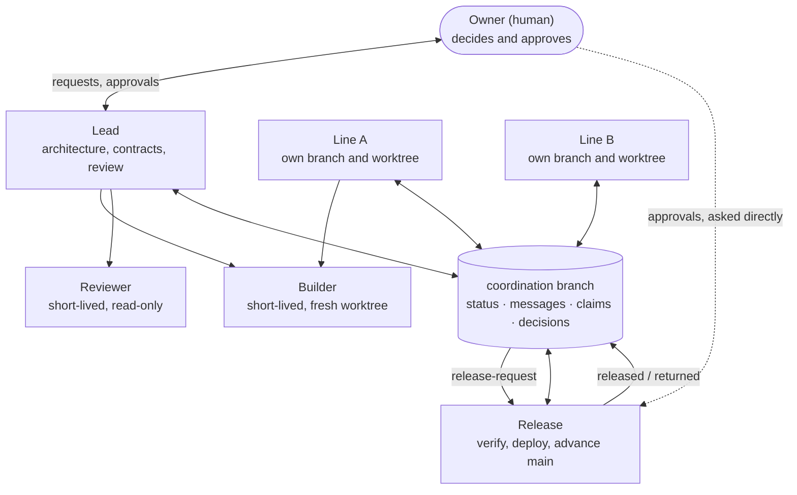

# Multi-Agent Protocol

[](https://github.com/gao-xh/multi-agent-protocol/actions/workflows/check.yml)

[中文说明](README.zh-CN.md)

A governance and release protocol for several AI coding agents (Claude Code, Codex and
others) that work on one project in parallel, on behalf of one human owner.

Orchestrators start agents, give them worktrees and show their progress. They mostly leave
open who may approve what, how agents hand work to each other, and how a change gets from a
finished branch to production without anyone cutting corners. This protocol covers that
part. It is a set of rules plus a few small tools, and it works with any orchestrator, or
with plain terminal sessions on different machines.

- **[PROTOCOL.md](PROTOCOL.md)**: the protocol (RFC 2119 wording, about 15 minutes to read).
- **[scripts/](scripts/)**: POSIX `sh` tools for the git-based coordination branch. They need only git.
- **[templates/](templates/)**: message templates (handover, release request, released, returned, heads-up, status, review packet).
- **[adapters/](adapters/)**: the `AGENTS.md` snippet, a bootstrap prompt for any agent, and notes for Codex.
- **Claude Code plugin**: role skills (`lead`, `line`, `release`, `coordinate`) and `builder` / `reviewer` agents.

## Why

Running several agents at once fails in predictable ways. Two sessions edit one working
tree. One agent tells another "the owner approved it". A deployment fails, but a pipe hides
the exit status and the main branch moves anyway. A long feature lands on a stale base. The
protocol is built around five things that prevent these:

1. **Owner authority.** Only the human owner approves. An approval relayed by another
   agent never counts. Standing authorizations are allowed, but they are recorded with
   their date, scope, exclusions and the owner's own words, and read narrowly.
2. **Isolation.** One writer per working tree, one branch per line of work, free ports and
   disposable databases for every test run.
3. **A dedicated release role** that verifies strictly: review, overlap check, local gate,
   CI on the exact SHA, approvals confirmed with the owner, one scripted deploy, success
   read from the real exit status, and only then the main branch moves.
4. **Build → independent review → fix → release.** New features are reviewed by an agent
   that did not build them, with ranked findings and evidence, for at most five rounds.
5. **Interface changes are announced before merge**, and the old form keeps working where
   feasible.

The protocol ends with a [table of real failure modes](PROTOCOL.md#11-known-failure-modes)
and the rule that prevents each one.

## Roles



Roles are responsibilities, not processes. One session may hold several roles in a small
project; in a larger one any role can run as several parallel sessions (many lines,
builders and reviewers at once; several leads split by area; several release sessions that
take turns on the main branch through a claim). A project can also add its own roles, such
as tester, documentation or security audit, as long as they keep the reserved powers
intact: only the owner approves and only the release role moves the main branch
([PROTOCOL.md 2.1](PROTOCOL.md#21-parallel-sessions-and-project-roles)). The roles, and
which tool runs each one, are listed in a table in the project's `AGENTS.md`.

## How agents talk

Every agent that can run git can use the **coordination branch**: an orphan branch in the
project's own repository, never merged.

```
status/<line>.md                            one file per line, changed only by that line
messages/<UTC timestamp>_<from>_<type>.md   one file per message, never changed after push
claims/<task-slug>.md                       who is doing which task, with a lease
decisions/<YYYY-MM-DD>_<topic>.md           owner decisions and standing authorizations
```

Messages are new files, so they never conflict. Each line keeps a `Last-read` pointer in its
status file and advances it only after acting on a message, so an interrupted session redoes
work instead of losing it. Agents without push notifications poll with `inbox.sh`, which
makes no model call and exits 1 when there is nothing new.

```sh
scripts/init-coordination.sh                 # once per project
scripts/inbox.sh --show api                  # unread messages for line "api"
scripts/send.sh --template handover > m.md   # fill it in, then:
scripts/send.sh m.md
scripts/mark-read.sh api <message-file>      # after handling it
scripts/claim.sh --hours 4 api fix-login     # exit 1: someone else has it
scripts/status.sh --all
scripts/doctor.sh                            # layout, immutable messages, stale claims
```

Tools that have their own messaging between sessions can use it for speed, but handovers,
release requests and their answers are still written to the branch.

## Three ways to use it

### 1. Claude Code plugin

```text
/plugin marketplace add gao-xh/multi-agent-protocol
/plugin install multi-agent-protocol@gao-xh-agents
```

Then start each session with its role: `/multi-agent-protocol:lead`,
`/multi-agent-protocol:line api`, `/multi-agent-protocol:release`, and use
`/multi-agent-protocol:coordinate` for the inbox, messages and claims. The `builder` and
`reviewer` agents become available for delegation; the reviewer has no edit tools and
cannot start other agents.

### 2. Bootstrap prompt, for any agent

Paste the prompt in [adapters/BOOTSTRAP.md](adapters/BOOTSTRAP.md) into Codex, Claude Code
or another agent inside your project. The agent reads the protocol, asks you for the role
table and any standing authorizations, adds the rules snippet to `AGENTS.md`, creates the
coordination branch and publishes its status. For Codex specifics (sandbox network access
for `git push`, `codex exec`, polling on a timer) see [adapters/codex.md](adapters/codex.md).

### 3. Copy the snippet

Copy [adapters/AGENTS.md.snippet](adapters/AGENTS.md.snippet) into your project's
`AGENTS.md` (Codex reads it; point `CLAUDE.md` to it for Claude Code), fill in the table,
and copy `scripts/` and `templates/` into the project, for example under
`tools/multi-agent-protocol/`.

## Tests

```sh
tests/test-scripts.sh        # with sh
tests/test-scripts.sh dash   # with another POSIX shell
```

The test builds a throwaway repository with a local bare remote, two clones and concurrent
pushes, and checks every script, including the doctor catching an edited message. CI
([.github/workflows/check.yml](.github/workflows/check.yml)) runs it on Linux (dash and bash)
and macOS, plus ShellCheck and `claude plugin validate --strict`.

## Related work

This protocol borrows ideas (not text) from these projects. It is meant to sit on top of
tools like them, not to replace them.

| Project | What it does | What this protocol takes or adds |
| --- | --- | --- |
| [OpenMOSS/claude-codex-handoff](https://github.com/OpenMOSS/claude-codex-handoff) | Serverless Claude Code and Codex collaboration in one folder: append-only message streams, lock files, timer wake-ups, cursors advanced only after side effects | Same crash-safe cursor rule (`Last-read`) and cheap timer polling; moves the board to a git branch so it works across machines, and adds roles, owner authority and a release process |
| [AnastasiyaW/mclaude](https://github.com/AnastasiyaW/mclaude) | File-based coordination for several Claude Code sessions: atomic locks, Markdown handoffs, addressed messages, an identity registry | Handovers that record failed approaches; claims with leases instead of locks; tool-agnostic, so Codex and others take part |
| [ComposioHQ/agent-orchestrator](https://github.com/ComposioHQ/agent-orchestrator) | Desktop workspace that plans tasks and runs many coding agents, each with its own branch, worktree and browser, tracked through PRs, CI and review | Complementary: use it to run agents, and this protocol for who approves, how releases are verified and when the main branch may move |
| [gitpcl/openorchestrator](https://github.com/gitpcl/openorchestrator) | Terminal control plane for parallel agents in worktrees, with conflict warnings and merge queuing | Same overlap idea, made a mandatory release step (warn other lines before merging) |
| [andyrewlee/awesome-agent-orchestrators](https://github.com/andyrewlee/awesome-agent-orchestrators) | Curated list of orchestrators, swarms, loop runners and agent infrastructure | Where to find an orchestrator to pair with this protocol |
| [Tessl "agent team operation" rule](https://tessl.io/registry/jbaruch/coding-policy/0.3.186/files/rules/agent-team-operation.md) | Rules for agent team rounds: rotating roles, self-contained briefs, one writer per worktree, report files, a cap on fix attempts, review before a PR | Self-contained messages, one writer per tree, a five-round fix cap, and independent review before release |

What is different here: approvals are never relayed (3.1), standing authorizations are
written down and read narrowly (3.3), a release role verifies against the exact SHA and the
real exit status before the main branch moves (7), interface changes are announced before
merge (5.3), and the rules are tied to a table of failures that actually happened (11).

## License

[MIT](LICENSE) © 2026 Xuehan Gao
