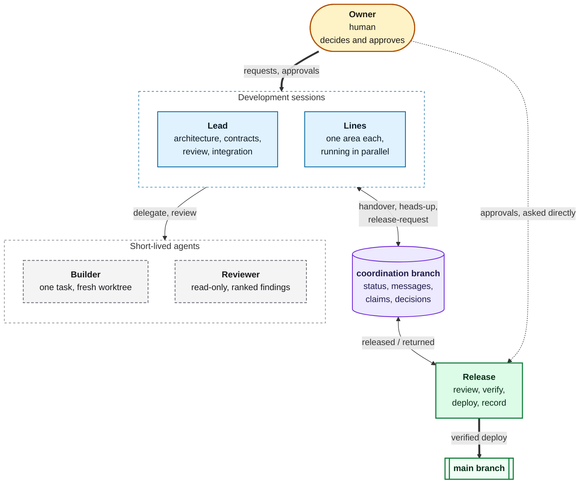

# Multi-Agent Protocol

[](https://github.com/gao-xh/multi-agent-protocol/actions/workflows/check.yml)
[](CHANGELOG.md)
[](LICENSE)

[中文说明](README.zh-CN.md)

> **For AI agents:** if you were given this link and asked to set the protocol up in a
> project, follow [adapters/BOOTSTRAP.md](adapters/BOOTSTRAP.md) step by step (raw text:
> https://raw.githubusercontent.com/gao-xh/multi-agent-protocol/main/adapters/BOOTSTRAP.md).
> It tells you what to check, what to ask the owner, and what to change only after they answer.

The Multi-Agent Protocol makes a group of AI coding agents (Claude Code, Codex and others)
actually work on your project together, as a team: a lead plans and hands out the work,
the other agents build their parts in parallel and review each other, and you only step in
for decisions.

> **2.0 is coming:** a release candidate with setup and join prompts, agents woken by new
> messages, and remote work is on the branch
> [`next`](https://github.com/gao-xh/multi-agent-protocol/tree/next) (tag
> [`v2.0.0-rc.3`](https://github.com/gao-xh/multi-agent-protocol/releases/tag/v2.0.0-rc.3)).
> This page describes the stable 1.3 release.

## How the team works

- **Division of work.** The lead splits a task into parts and gives each to a line of
  work: one agent with its own branch and an area of the project, listed in a role table.
  Lines build in parallel, and any role can run as several sessions.
- **Handing out work and handing it over.** Work moves as written messages on a
  coordination branch in your own repository: a handover carries the goal, the facts so
  far and the checks to run; a claim keeps two agents from starting the same task; status
  files show who does what. A whole line can move to another agent or machine and carry on.
- **Picking up where others left off.** Each session starts with a summary of its unread
  messages and claims, and an agent can check its inbox on a timer without a model call.
- **Any tools, any machines.** Claude Code, Codex, OpenCode, Aider and others share one
  team through plain git.

## Quality you can check

- **Independent review.** An agent that did not build a change reviews it, with ranked
  findings and evidence.
- **One release role** advances the main branch, after the checks pass on the exact commit
  and the approvals are confirmed.
- **"Done" means** a pushed commit SHA plus the checks that actually ran.

## You stay in charge

- **Only you approve.** An approval relayed by another agent never counts.
- **Standing authorizations** are allowed, recorded in your own words with their scope and
  exclusions; a record signed with your SSH key lets you approve from elsewhere.

## Under the hood

The teamwork rests on a few plain rules, so that parallel work does not collide: one
writer per working tree, one branch per line, a claim before work starts, interface
changes announced before they merge, and a [table of real failure
modes](PROTOCOL.md#11-known-failure-modes) with the rule that prevents each one. It is a
set of rules plus a few small tools; it works with any orchestrator, or with plain
terminal sessions on different machines.

- **[PROTOCOL.md](PROTOCOL.md)**: the protocol (RFC 2119 wording, about 15 minutes to read).
- **[scripts/](scripts/)**: POSIX `sh` tools for the git-based coordination branch. They need only git.
- **[templates/](templates/)**: message templates (handover, release request, released, returned, heads-up, status, review packet; `send.sh --template question` and `answer` print the short ones).
- **[adapters/](adapters/)**: the `AGENTS.md` snippet, a setup prompt for any agent, and notes per tool.
- **Claude Code plugin**: role skills (`lead`, `line`, `release`, `coordinate`) and `builder` / `reviewer` agents.

## Getting started

### 1. Set up the project

In your project, tell the agent that will lead (Claude Code, Codex or another): "Set up
this project with https://github.com/gao-xh/multi-agent-protocol". It follows
[adapters/BOOTSTRAP.md](adapters/BOOTSTRAP.md) by itself: it reads the protocol, asks you
for the role table and any standing authorizations, adds the rules to `AGENTS.md`, creates
the coordination branch and publishes its status.

Start small: one owner and two or three sessions need only the core rules; the
coordination branch and the release role come in as you add sessions, machines, tools or
owners ([profiles](PROTOCOL.md#121-profiles)).

### 2. Start the other agents

Open each agent in its own worktree and tell it its line: "You are line `api` in this
project; follow the Multi-Agent Protocol in AGENTS.md." With the Claude Code plugin, start
it with its role instead (below).

### 3. Claude Code plugin (optional)

```text
/plugin marketplace add gao-xh/multi-agent-protocol
/plugin install multi-agent-protocol@gao-xh-agents
/multi-agent-protocol:coordinate set-line api      # once per worktree
```

Start each session with its role (`/multi-agent-protocol:lead`, `/multi-agent-protocol:line
api`, `/multi-agent-protocol:release`); `/multi-agent-protocol:coordinate` handles the
inbox, messages and claims, and `builder` and `reviewer` agents take delegated work. With a
line name set, each session starts with its unread messages and claims.

### 4. By hand

```sh
git clone https://github.com/gao-xh/multi-agent-protocol
multi-agent-protocol/scripts/install.sh path/to/your-project   # rerun later to update
```

This copies the protocol, scripts and templates into `tools/multi-agent-protocol/` and
changes nothing else. Paste the snippet into `AGENTS.md` (point `CLAUDE.md` to it for
Claude Code), fill in the role table, and run
`tools/multi-agent-protocol/scripts/init-coordination.sh`.

### Reference

- Agent tools: [Codex](adapters/codex.md) (sandbox network access for `git push`, `codex
  exec`, polling on a timer), [OpenCode](adapters/opencode.md) and
  [Aider](adapters/aider.md).
- Smaller or cheaper models: [adapters/compact-rules.md](adapters/compact-rules.md).

## Roles



Roles are responsibilities, not processes. One session may hold several roles in a small
project; in a larger one any role can run as several parallel sessions (many lines,
builders and reviewers at once; several leads split by area; several release sessions that
take turns on the main branch through a claim). A project can also add its own roles, such
as tester, documentation or security audit, as long as they keep the reserved powers
intact: only the owner approves and only the release role moves the main branch
([PROTOCOL.md 2.1](PROTOCOL.md#21-parallel-sessions-and-project-roles)). The roles, and
which tool runs each one, are listed in a table in the project's `AGENTS.md`.

## How agents talk

Every agent that can run git can use the **coordination branch**: an orphan branch in the
project's own repository, never merged.

```
status/<line>.md                            one file per line, changed only by that line
messages/<UTC timestamp>_<from>_<type>.md   one file per message, never changed after push
claims/<task-slug>.md                       who is doing which task, with a lease
decisions/<YYYY-MM-DD>_<topic>.md           owner decisions and standing authorizations
```

A whole line can also move to another agent or machine: the giving session pushes
everything and leaves a `transfer` handover addressed to its own line name, and the
receiving session, under the same name, reads it first and checks every branch SHA.

When a session joins, its status file describes its environment (tool, model, a machine
label, sandbox and network access, what it can and cannot run) and it announces itself to
all, so the others know what to hand it. Messages are new files, so they never conflict. Each line keeps a `Last-read` pointer in its
status file and advances it only after acting on a message, so an interrupted session redoes
work instead of losing it. Agents without push notifications poll with `inbox.sh`, which
makes no model call and exits 1 when there is nothing new.

```sh
scripts/init-coordination.sh                 # once per project
scripts/inbox.sh --show api                  # unread messages for line "api"
scripts/send.sh --template handover > m.md   # fill it in, then:
scripts/send.sh m.md
scripts/mark-read.sh api <message-file>      # after handling it
scripts/claim.sh --hours 4 api fix-login     # exit 1: someone else has it
scripts/status.sh --all
scripts/doctor.sh                            # layout, immutable messages, stale claims
scripts/decide.sh <topic> decision.md        # record an owner decision
scripts/verify.sh decisions/<file>           # is this approval really signed by the owner?
```

Tools that have their own messaging between sessions can use it for speed, but handovers,
release requests and their answers are still written to the branch.

## Tests

```sh
tests/test-scripts.sh        # with sh
tests/test-scripts.sh dash   # with another POSIX shell
```

The test builds a throwaway repository with a local bare remote, two clones and concurrent
pushes, and checks every script, including the doctor catching an edited message. CI
([.github/workflows/check.yml](.github/workflows/check.yml)) runs it on Linux (dash and bash)
and macOS, plus ShellCheck and `claude plugin validate --strict`.

## License

[MIT](LICENSE) © 2026 Xuehan Gao
