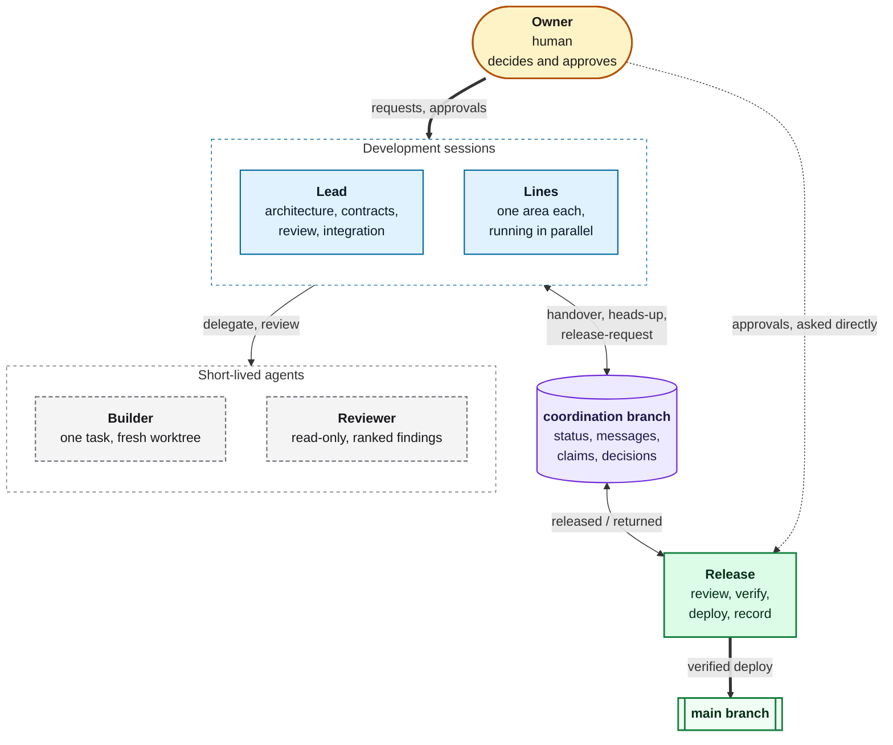

# How MAP works

The roles and the coordination branch in more detail. The protocol itself is
[PROTOCOL.md](../PROTOCOL.md); this page summarizes it.

## Roles



Roles are responsibilities, not processes. One session may hold several roles in a small
project; in a larger one any role can run as several parallel sessions (many lines,
builders and reviewers at once; several leads split by area; several release sessions that
take turns on the main branch through a claim). A project can also add its own roles, such
as tester, documentation or security audit, as long as they keep the reserved powers
intact: only the owner approves and only the release role (or the role the project names
for that work) moves the main branch
([PROTOCOL.md 2.1](../PROTOCOL.md#21-parallel-sessions-and-project-roles)). The roles, and
which tool runs each one, are listed in a table in the project's `AGENTS.md`. The roles
and permissions are defaults: a project may rename, combine or leave out roles and change
who may do what, and add their own message types, in the same file, approved the way the
project chose at setup (by default proposals go through the lead to the owner); approvals, the single
session that moves the main branch and independent review stay as they are
([PROTOCOL.md 2.2](../PROTOCOL.md#22-customizing-roles-and-permissions)).

## How agents talk

Every agent that can run git can use the **coordination branch**: an orphan branch in the
project's own repository, never merged.

```
status/<line>.md                            one file per line, changed only by that line
messages/<UTC timestamp>_<from>_<type>.md   one file per message, never changed after push
claims/<task-slug>.md                       who is doing which task, with a lease
decisions/<YYYY-MM-DD>_<topic>.md           owner decisions and standing authorizations
```

A whole line can also move to another agent or machine: the giving session pushes
everything and leaves a `transfer` handover addressed to its own line name, and the
receiving session, under the same name, reads it first and checks every branch SHA.

When a session joins, its status file describes its environment (tool, model, a machine
label, sandbox and network access, what it can and cannot run, how a new message wakes it,
whether it can push the coordination branch, whether the owner is usually present, the
git identity it commits under: by default its line name) and it
announces itself to all, so the others know what to hand it. Messages are new files, so they never conflict. Each line keeps a `Last-read` pointer in its
status file and advances it only after acting on a message, so an interrupted session redoes
work instead of losing it. Agents without push notifications poll with `inbox.sh`, which
makes no model call and exits 1 when there is nothing new, or run `watch.sh`, which prints
one line per new message (one summary line when more than three arrive at once) for a
tool that turns output into a notification.

```sh
scripts/init-coordination.sh                 # once per project
scripts/inbox.sh --show api                  # unread messages for line "api"
scripts/watch.sh --once api                  # print what is new (or wait for it), then exit
scripts/send.sh --template handover > m.md   # fill it in, then:
scripts/send.sh m.md
scripts/send.sh --allow-secret m.md          # only if a refused value is not a secret
scripts/mark-read.sh api <message-file>      # after handling it
scripts/claim.sh --hours 4 api fix-login     # exit 1: someone else has it
scripts/status.sh --all
scripts/doctor.sh                            # layout, immutable messages, stale claims
scripts/decide.sh <topic> decision.md        # record an owner decision
scripts/verify.sh decisions/<file>           # is this approval really signed by the owner?
```

Tools that have their own messaging between sessions can use it for speed, but handovers,
release requests and their answers are still written to the branch.

